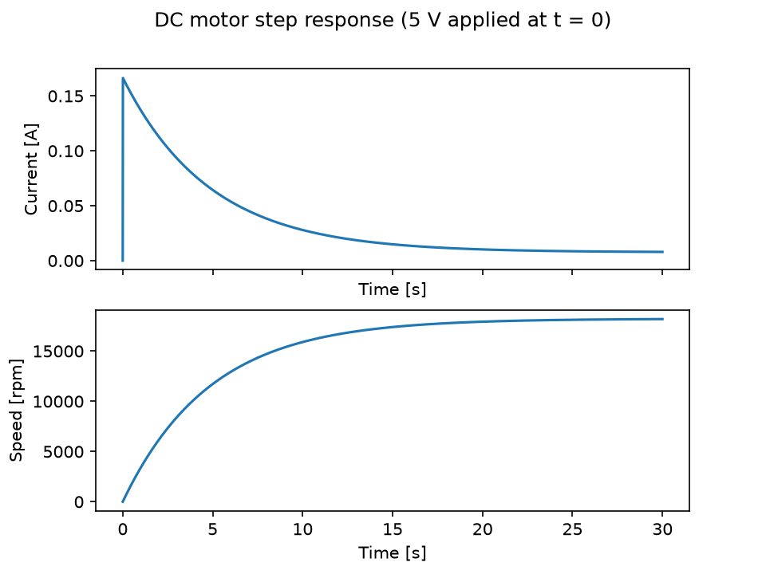
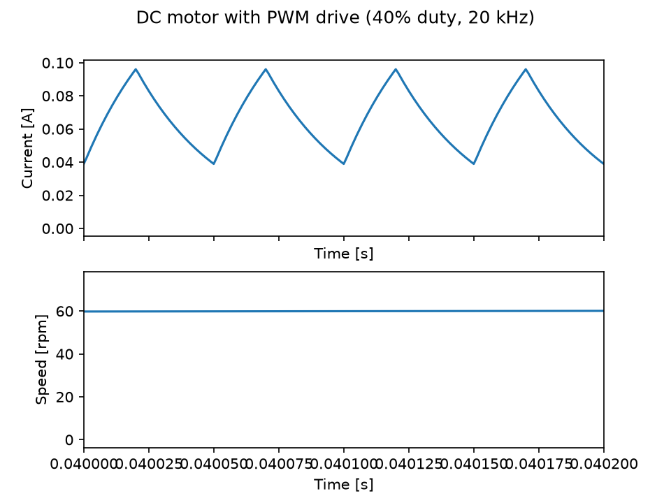
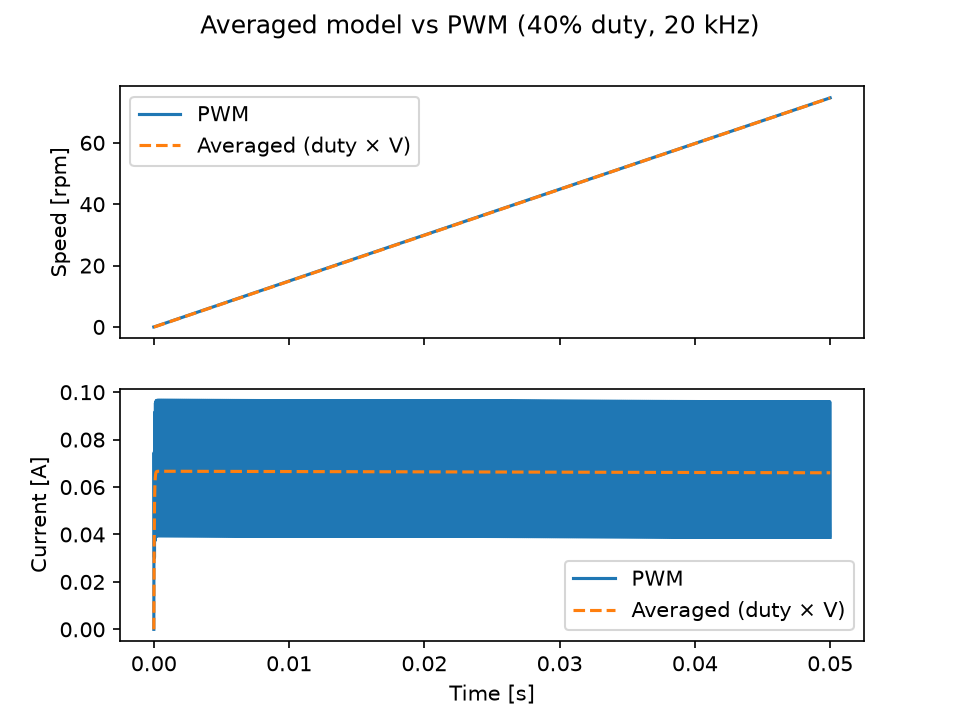

# CubeSat Reaction Wheel: Closed-Loop Drive Simulation

## Project goal

This project simulates the drive of a small CubeSat-class reaction wheel: a brushed DC motor model, a PWM motor driver, and a PID speed controller. The stability of the closed loop will then be checked with frequency-domain tools. The aim is to build the full chain step by step in Python, then rebuild it in Simulink and compare the two.

## Roadmap

- [x] Step 2: Open-loop DC motor model, scaled to a CubeSat wheel
- [x] Step 3: PWM drive
- [ ] Step 4: PID speed control
- [ ] Step 5: Stability analysis (Bode plot, gain and phase margin)
- [ ] Step 6: Simulink rebuild
- [ ] Step 7: Python vs Simulink comparison

## Model parameters

| Parameter | Value | Origin |
|---|---|---|
| Supply voltage V | 5 V | From public product listing, to be verified |
| Armature resistance R | 30 Ω | My modelling choice |
| Armature inductance L | 1 mH | My modelling choice |
| Back-EMF / torque constant Ke = Kt | 0.0025 V·s/rad (= N·m/A) | My modelling choice |
| Rotor + wheel inertia J | 1.06e-6 kg·m² | Derived from listed momentum ÷ listed max speed (2 mNms ÷ 18,000 rpm), to be verified |
| Viscous friction b | 1e-8 N·m·s/rad | My modelling choice |
| Drive current limit I_max | 0.16 A (not used until Step 3) | My modelling choice |
| Peak torque (target) | 0.4 mNm | From public product listing, to be verified |
| Max speed (target) | 18,000 rpm | From public product listing, to be verified |
| Angular momentum (target) | 2 mNms | From public product listing, to be verified |

None of these values are taken from a manufacturer datasheet.

## Results

### Step 2: Open-loop spin-up



This shows a 5 V step applied to the motor at rest, simulated for 30 s:

- **Current** (top) jumps almost immediately to its peak of about 0.166 A. It then decays smoothly as back-EMF builds up, ending at about 0.008 A at t = 30 s.
- **Speed** (bottom) rises like a first-order system. It reaches 63% of its 30 s value after about 4.8 s, 95% after about 14.4 s, and is nearly flat at about 18,190 rpm by t = 30 s.

For comparison with the listed targets: the simulated peak torque (Kt × peak current) is about 0.42 mNm, and the momentum at t = 30 s (J × ω) is about 2.02 mNms. The peak current (0.166 A) goes slightly above I_max (0.16 A), because this open-loop model has no current limit yet. Current limiting is planned for Step 3.

### Step 3: PWM drive

PWM (pulse-width modulation) switches the full supply voltage on and off very quickly. Changing the duty cycle changes the *average* voltage the motor sees. The switch is either fully on or fully off, so little power is lost as heat, unlike a linear driver that burns the extra voltage. Simulating every 50 µs switching edge needs microsecond time steps, so PWM is only simulated in short windows. Long runs (PID, stability) will use the averaged model, after checking below that it matches.

Settings: 5 V supply, 20 kHz switching (50 µs period), 40% duty cycle, starting at rest, 0 to 0.05 s.

**Zoom (t = 40.0 to 40.2 ms, about 4 switching cycles)**



The current follows a saw-tooth. It rises during the on-time and falls during the off-time, between about 0.039 A and 0.096 A. Over this short window the speed is flat at about 60 rpm.

**Overview (0 to 0.05 s)**


At this scale the ripple looks like a solid band. After a very short start-up, the current settles into the same 0.04 to 0.10 A band. The speed rises almost linearly and reaches about 74.7 rpm at 0.05 s. This is the very start of a spin-up that takes seconds (see Step 2).

**Averaged model vs PWM (0 to 0.05 s, same solver settings)**



The averaged model replaces the switching voltage with a constant duty × V = 2 V. The two speed curves lie on top of each other. At 0.05 s, the PWM run reaches 74.659 rpm and the averaged run 74.639 rpm, a difference of +0.026%. The averaged current is a flat line at about 0.066 A, which matches the mean of the PWM ripple over the last 10 ms (0.0661 A). The averaged model therefore loses the ripple but keeps the speed and mean current, which is what the speed controller cares about.

## How to run

```bash
python -m venv .venv
# Windows: .venv\Scripts\activate    macOS/Linux: source .venv/bin/activate
pip install -r requirements.txt
python src/step2_motor_model.py
python src/step3_pwm_drive.py
python src/step3b_average_vs_pwm.py
```

Each script opens a plot window and saves its figures to `figures/`.

## Repository layout

```
README.md
requirements.txt
src/
  step2_motor_model.py    # Step 2: open-loop motor model
  step3_pwm_drive.py      # Step 3: PWM drive
  step3b_average_vs_pwm.py  # Step 3b: averaged model vs PWM
  (step4_pid.py, step5_stability.py to come)
figures/                  # plots saved by the scripts
simulink/                 # Step 6 models (placeholder)
```
