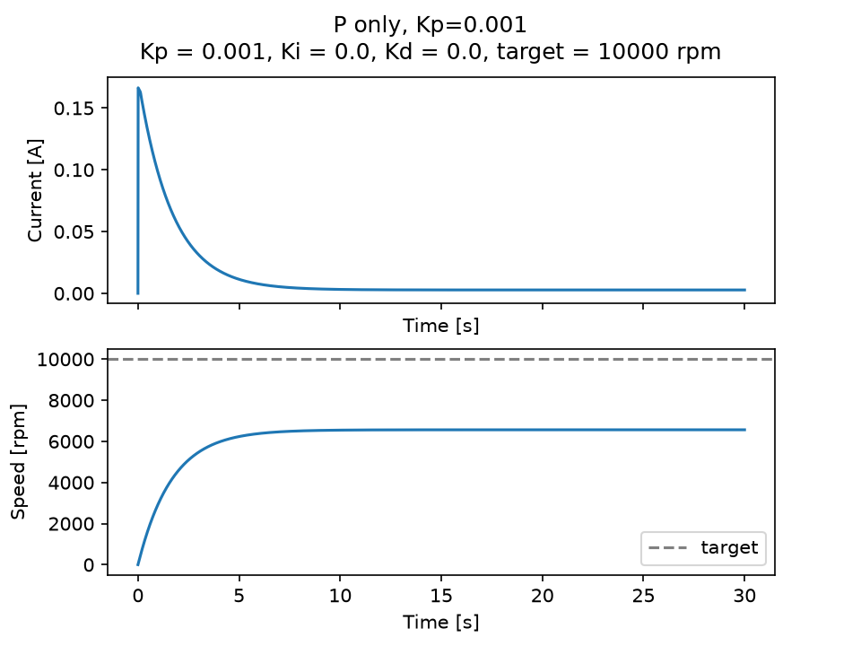
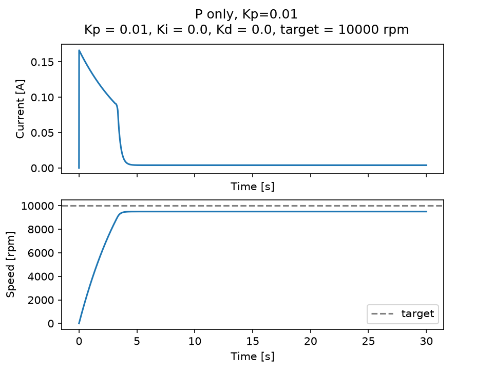
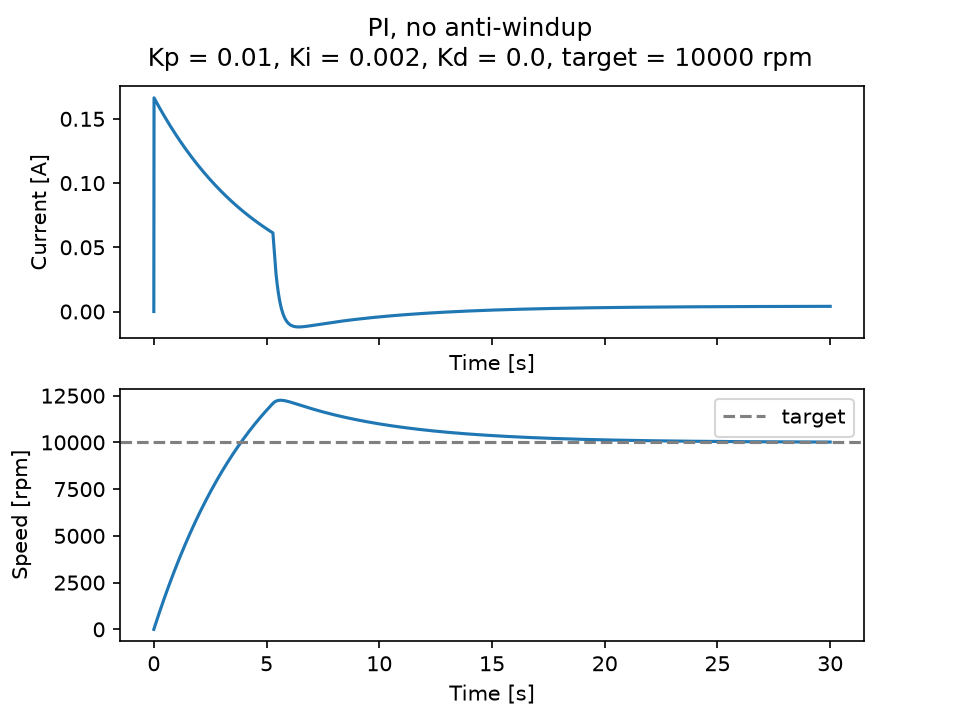
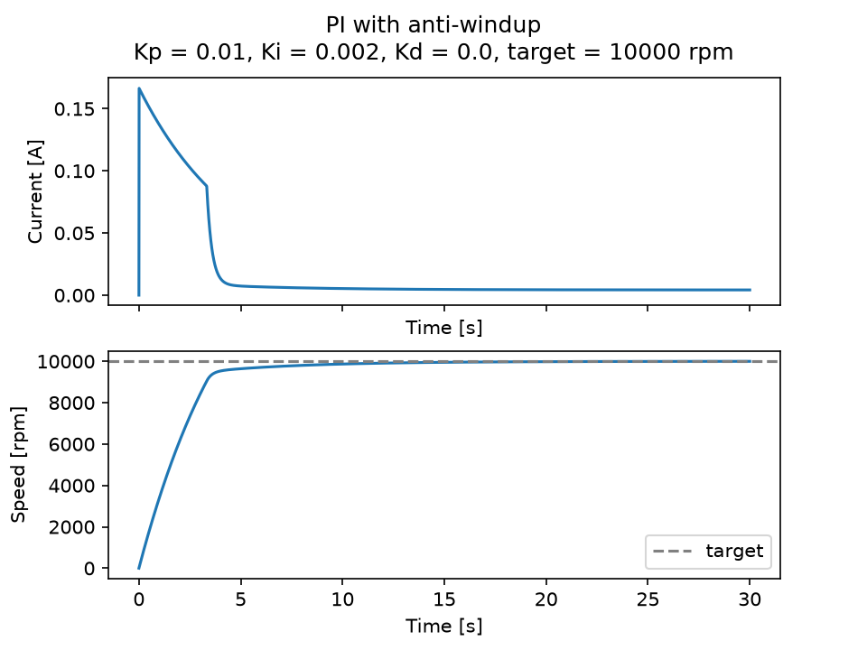
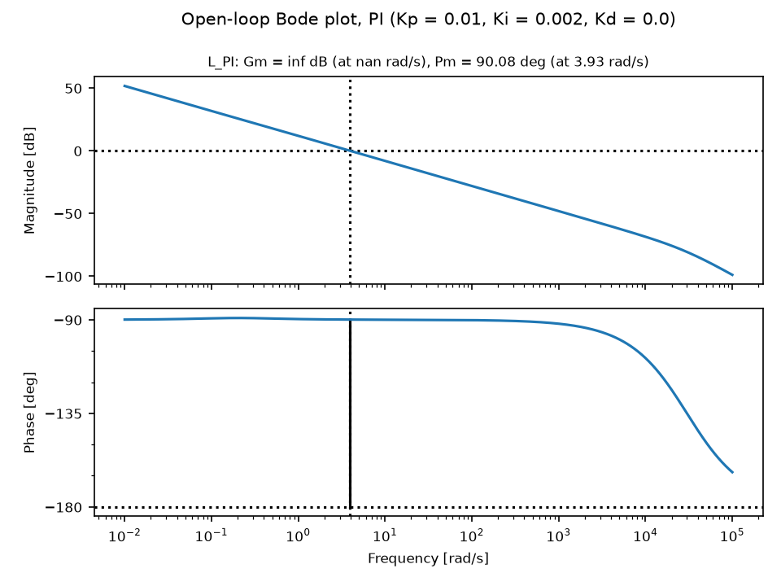
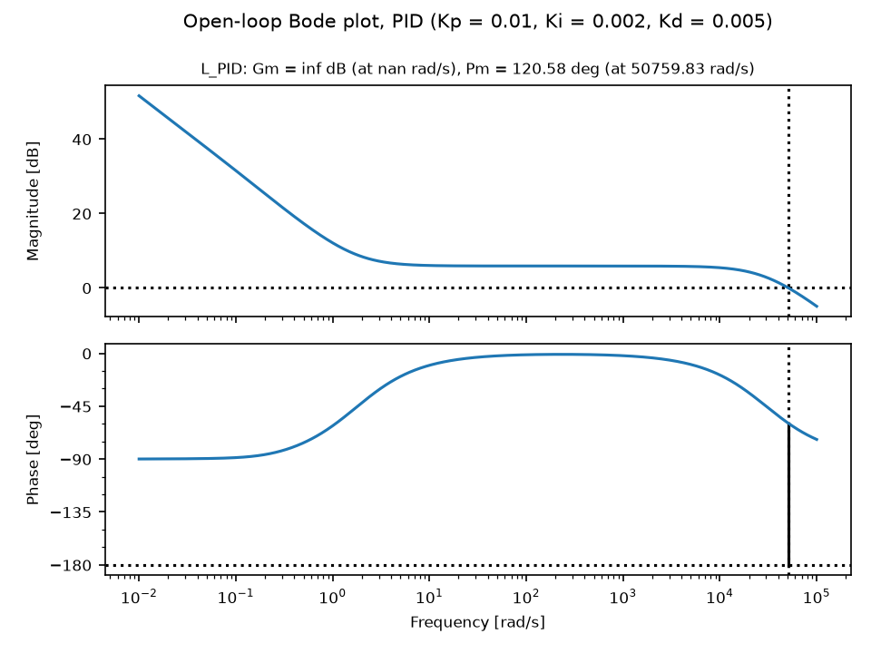
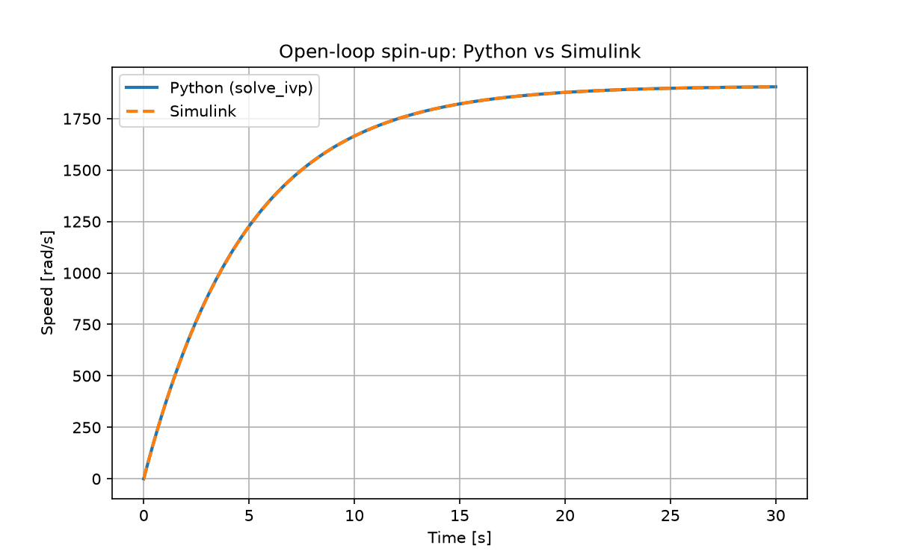

# CubeSat Reaction Wheel: Closed-Loop Drive Simulation

## Project goal

This project simulates the drive of a small CubeSat-class reaction wheel: a brushed DC motor model, a PWM motor driver, and a PID speed controller. The stability of the closed loop is then checked with frequency-domain tools. The full chain is built step by step in Python, and the motor model is rebuilt in Simulink and compared against the Python version.

## What this project demonstrates

- **Modelling an electromechanical system from first principles:** two coupled equations (electrical and mechanical) for a DC motor and flywheel. Open loop, the model spins up to about 18,190 rpm and 2.02 mNms, close to the listed 18,000 rpm and 2 mNms.
- **Simulating a switching drive:** a 20 kHz PWM driver, checked against a simpler averaged model (0.026% difference in speed), plus a current-limit demo.
- **Diagnosing and fixing integral windup:** a PI controller overshoots by 22.6% because its integral builds up while the drive is saturated. Anti-windup removes the overshoot completely.
- **Frequency-domain stability analysis:** Bode plots and stability margins show that adding a D term pushes the crossover frequency to about 8 kHz, too fast for a realistic controller. The simpler PI controller is the better choice.
- **Cross-validation in two independent tools:** the same motor model built in Simulink from basic blocks matches the Python result to within 0.013%.

## Roadmap

- [x] Step 2: Open-loop DC motor model, scaled to a CubeSat wheel
- [x] Step 3: PWM drive
- [x] Step 4: PID speed control
- [x] Step 5: Stability analysis (Bode plot, gain and phase margin)
- [x] Step 6: Simulink rebuild
- [x] Step 7: Python vs Simulink comparison

## Model parameters

| Parameter | Value | Origin |
|---|---|---|
| Supply voltage V | 5 V | From public product listing, to be verified |
| Armature resistance R | 30 Ω | My modelling choice |
| Armature inductance L | 1 mH | My modelling choice |
| Back-EMF / torque constant Ke = Kt | 0.0025 V·s/rad (= N·m/A) | My modelling choice |
| Rotor + wheel inertia J | 1.06e-6 kg·m² | Derived from listed momentum ÷ listed max speed (2 mNms ÷ 18,000 rpm), to be verified |
| Viscous friction b | 1e-8 N·m·s/rad | My modelling choice |
| Drive current rating I_max | 0.16 A (reference value; not enforced in the models) | My modelling choice |
| Peak torque (target) | 0.4 mNm | From public product listing, to be verified |
| Max speed (target) | 18,000 rpm | From public product listing, to be verified |
| Angular momentum (target) | 2 mNms | From public product listing, to be verified |

None of these values are taken from a manufacturer datasheet.

## Results

### Step 2: Open-loop spin-up


This shows a 5 V step applied to the motor at rest, simulated for 30 s:

- **Current** (top) jumps almost immediately to its peak of about 0.166 A. It then decays smoothly as back-EMF builds up, ending at about 0.008 A at t = 30 s.
- **Speed** (bottom) rises like a first-order system. It reaches 63% of its 30 s value after about 4.8 s, 95% after about 14.4 s, and is nearly flat at about 18,190 rpm by t = 30 s.

For comparison with the listed targets: the simulated peak torque (Kt × peak current) is about 0.42 mNm, and the momentum at t = 30 s (J × ω) is about 2.02 mNms. The peak current (0.166 A) goes slightly above I_max (0.16 A), because this open-loop model has no current limit. A current-limit demo follows in Step 3c.

### Step 3: PWM drive

PWM (pulse-width modulation) switches the full supply voltage on and off very quickly. Changing the duty cycle changes the *average* voltage the motor sees. The switch is either fully on or fully off, so little power is lost as heat, unlike a linear driver that burns the extra voltage. Simulating every 50 µs switching edge needs microsecond time steps, so PWM is only simulated in short windows. Long runs (PID, stability) will use the averaged model, after checking below that it matches.

Settings: 5 V supply, 20 kHz switching (50 µs period), 40% duty cycle, starting at rest, 0 to 0.05 s.

**Zoom (t = 40.0 to 40.2 ms, about 4 switching cycles)**


The current follows a saw-tooth. It rises during the on-time and falls during the off-time, between about 0.039 A and 0.096 A. Over this short window the speed is flat at about 60 rpm.

**Overview (0 to 0.05 s)**


At this scale the ripple looks like a solid band. After a very short start-up, the current settles into the same 0.04 to 0.10 A band. The speed rises almost linearly and reaches about 74.7 rpm at 0.05 s. This is the very start of a spin-up that takes seconds (see Step 2).

**Averaged model vs PWM (0 to 0.05 s, same solver settings)**


The averaged model replaces the switching voltage with a constant duty × V = 2 V. The two speed curves lie on top of each other. At 0.05 s, the PWM run reaches 74.659 rpm and the averaged run 74.639 rpm, a difference of +0.026%. The averaged current is a flat line at about 0.066 A, which matches the mean of the PWM ripple over the last 10 ms (0.0661 A). The averaged model therefore loses the ripple but keeps the speed and mean current, which is what the speed controller cares about.

### Step 3c: Current limit (demo)

The drive switches the voltage off whenever the current reaches a limit, and back on once it drops below it. The demo uses 100% duty, so without a limit the current would head for the full stall value. The limit is set to 0.08 A on purpose, half of I_max (0.16 A), so its effect is easy to see. The run covers 0 to 0.01 s with `max_step=1e-7`.

**Zoom (first 500 µs)**


**Overview (0 to 0.01 s)**


The current rises from zero and reaches 0.08 A after about 22 µs. From then on it stays pinned at the limit (0.07999 to 0.08003 A after 5 ms). With the current held constant, the torque is constant too, so the speed rises in a straight line to about 18 rpm at 0.01 s.

Note: this limiter switches on and off at every solver step around the limit, so in the model its switching rate is set by `max_step`, not by real hardware. A real driver would usually limit once per PWM cycle or use a small hysteresis band.

### Step 4: PID speed control

The controller sets the duty cycle (clipped to 0 to 1) from the speed error. The motor sees the averaged voltage duty × V, as checked in Step 3b. The derivative term acts on the measured acceleration rather than on the error. Target: 10,000 rpm from rest, simulated for 30 s. One script runs five controller settings so the progression is visible:

| Case | Kp | Ki | Kd | Anti-windup | Final speed | Peak speed | Overshoot | 2% settling time |
|---|---|---|---|---|---|---|---|---|
| 1. P only | 0.001 | 0 | 0 | No | 6,561.7 rpm | 6,561.7 rpm | 0% | Not settled in 30 s |
| 2. P only | 0.01 | 0 | 0 | No | 9,502.1 rpm | 9,502.1 rpm | 0% | Not settled in 30 s |
| 3. PI | 0.01 | 0.002 | 0 | No | 10,018.3 rpm | 12,254.6 rpm | 22.55% | 18.02 s |
| 4. PI | 0.01 | 0.002 | 0 | Yes | 9,997.6 rpm | 9,997.6 rpm | 0% | 7.92 s |
| 5. PID | 0.01 | 0.002 | 0.005 | Yes | 9,999.5 rpm | 9,999.5 rpm | 0% | 5.61 s |

**1. P only, Kp = 0.001.** The speed levels off at about 6,560 rpm, well below the target. A proportional controller needs a remaining error to keep producing a duty cycle.



**2. P only, Kp = 0.01.** A higher gain gets closer (about 9,500 rpm) but still leaves a steady error of about 5%.



**3. PI, no anti-windup.** The integral term removes the steady error, but the speed overshoots to about 12,250 rpm and takes 18 s to settle. While the duty cycle is stuck at 100% during spin-up, the integral keeps adding up error it cannot act on ("windup"). It then has to unwind, and during that time the duty cycle is clipped to 0 and the current briefly goes slightly negative (braking).



**4. PI with anti-windup.** Anti-windup freezes the integral while the duty cycle is saturated, so it only builds up once the controller can actually act. The overshoot disappears and the speed settles within 2% after 7.9 s.



**5. PID with anti-windup.** Adding the D term shortens the 2% settling time to 5.6 s, still without overshoot. Comparing cases 3 and 4 shows that anti-windup, not the D term, is what removed the overshoot. Step 5 looks at whether the D term is worth keeping.


In every case the current starts at about 0.166 A, slightly above I_max, because this model has no current limit.

### Step 5: Stability analysis (Bode plots)

The open loop (controller × supply voltage × motor) is analysed for the PI controller (Kd = 0) and the PID controller (Kd = 0.005), with Kp = 0.01 and Ki = 0.002 in both. This is the linear model: it ignores the duty clipping and anti-windup, so the margins only describe the controller in its unsaturated operating region.

- **Gain margin:** how much the loop gain could be multiplied before the system becomes unstable.
- **Phase margin:** how much extra delay (phase lag) the loop could tolerate at the crossover frequency before it becomes unstable.





| Controller | Gain margin | Phase margin | Crossover frequency |
|---|---|---|---|
| PI (Kd = 0) | Infinite | 90.1° | 3.93 rad/s (0.63 Hz) |
| PID (Kd = 0.005) | Infinite | 120.6° | 50,760 rad/s (8,079 Hz) |

**Conclusion.** The gain margin is infinite in both cases because the phase never reaches −180°, and both phase margins are healthy. However, the PID crossover is at about 8 kHz, in the electrical frequency range. A real digital controller would need a sample rate far above that. The PI crossover is at about 4 rad/s, in the mechanical range, and is easy to implement. The D term is therefore not earning its place: in Step 4 it was the anti-windup, not the D term, that removed the overshoot.

### Step 6: Simulink rebuild

The open-loop motor model from Step 2 is rebuilt in Simulink from basic blocks (Sum, Gain and Integrator), rather than a ready-made motor block. Each block maps directly to a term in the two equations:

- Electrical: L · di/dt = V − R·i − Ke·ω
- Mechanical: J · dω/dt = Kt·i − b·ω

A Step block applies V = 5 V at t = 0, and two To Workspace blocks record speed (`omega_sim`) and current (`i_sim`). The parameters live in `simulink/params.m`, which must run before simulating. It is wired to the model's PreLoadFcn, so it runs automatically when the model is opened.

### Step 7: Python vs Simulink comparison



Both tools simulate the same 5 V open-loop spin-up for 30 s. Speed is shown in rad/s here: the final 1,904.4 rad/s equals about 18,186 rpm, matching Step 2. The two curves lie on top of each other. The largest difference is 0.25 rad/s, which is 0.013% of the final speed. The remaining difference comes from the two solvers taking different time steps (Simulink's variable-step solver against Python's `solve_ivp`), not from the model itself.

## How to run

```bash
python -m venv .venv
# Windows: .venv\Scripts\activate    macOS/Linux: source .venv/bin/activate
pip install -r requirements.txt
python src/step2_motor_model.py
python src/step3_pwm_drive.py
python src/step3b_average_vs_pwm.py
python src/step3c_current_limit.py
python src/step4_pid.py
python src/step5_bode.py
python src/step7_python_vs_simulink.py
```

Each script opens a plot window and saves its figures to `figures/`. Step 7 reads the Simulink results already exported to `simulink/*.csv`, so it does not need MATLAB. To re-run the Simulink model itself, open `simulink/step6_motor_simulink.slx` in MATLAB (`params.m` loads automatically) and run the simulation.

## Repository layout

```
README.md
requirements.txt
src/
  step2_motor_model.py    # Step 2: open-loop motor model
  step3_pwm_drive.py      # Step 3: PWM drive
  step3b_average_vs_pwm.py  # Step 3b: averaged model vs PWM
  step3c_current_limit.py   # Step 3c: current limit demo
  step4_pid.py              # Step 4: P, PI and PID speed control, with and without anti-windup
  step5_bode.py             # Step 5: open-loop Bode plots and stability margins (PI and PID)
  step7_python_vs_simulink.py  # Step 7: compare Simulink results with Python
figures/                  # plots saved by the scripts
simulink/
  step6_motor_simulink.slx  # Step 6: motor model built from basic blocks
  params.m                  # model parameters (runs on model load)
  simulink_speed.csv        # exported Simulink speed [rad/s] (time, value)
  simulink_current.csv      # exported Simulink current [A] (time, value)
```

## Next steps

This model is intended as the foundation for a planned bachelor thesis on fault injection in drive controllers. The idea is to inject simulated bit flips into the control loop (for example into the speed measurement, the controller state or the duty-cycle command) and measure the mechanical consequences: speed error, torque ripple and stall. None of this has been implemented yet.

---

**On tooling.** I used Claude as an assistant for this project: for working through the theory, debugging, repository setup and documentation. The modelling decisions, parameter choices and the analysis conclusions are my own, and I ran and checked every result in the repo.
